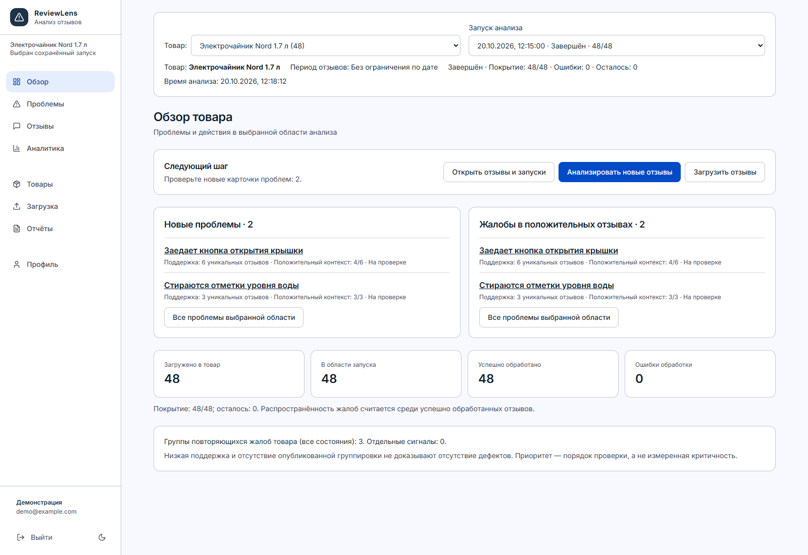
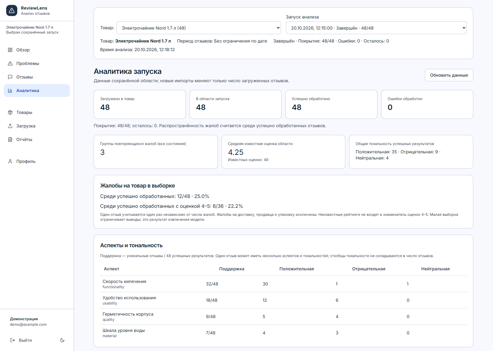
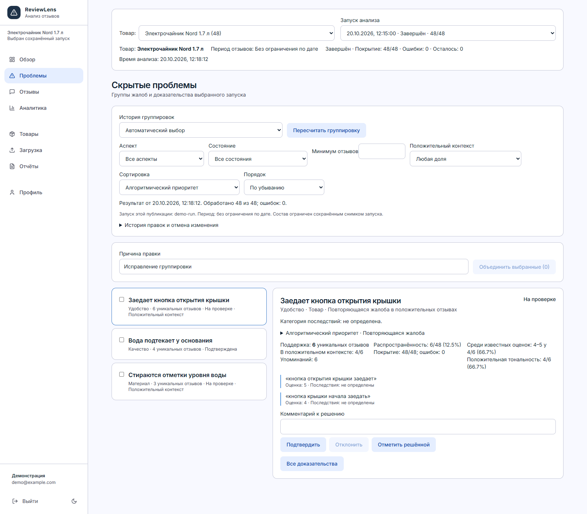
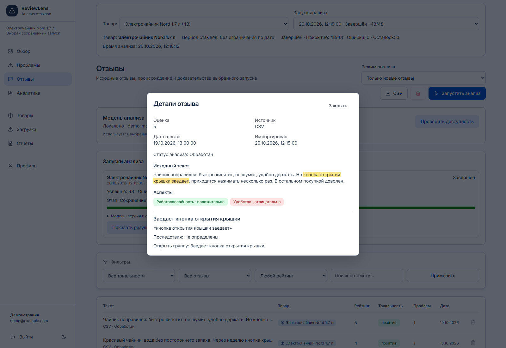
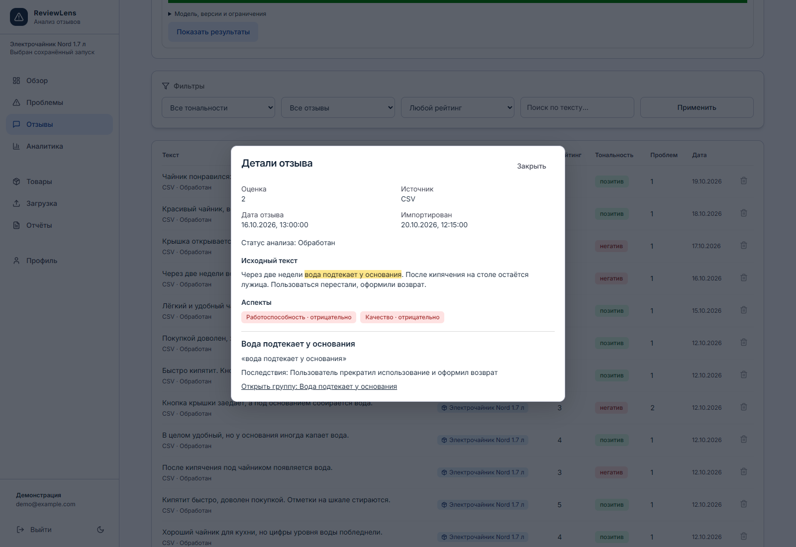
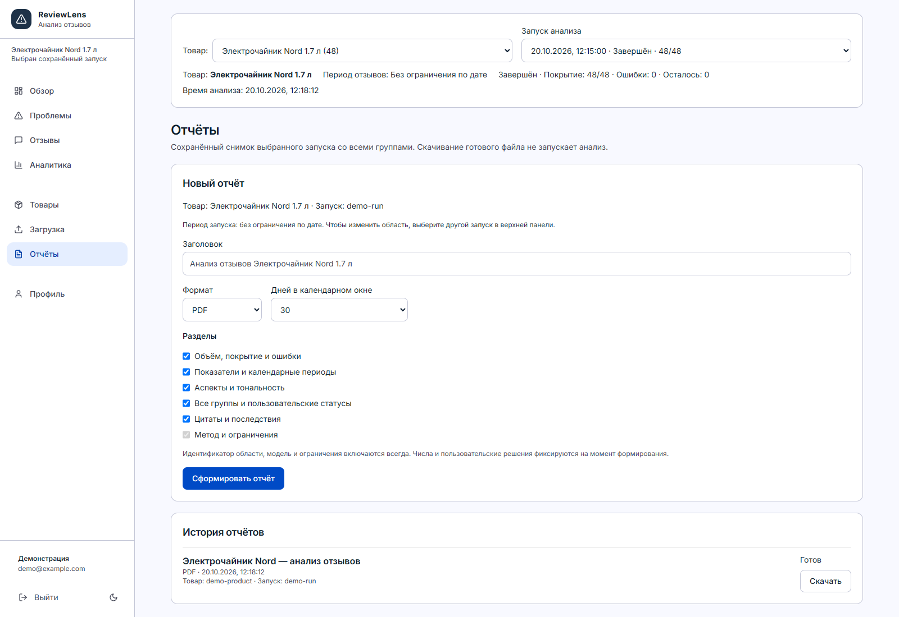

# ReviewLens

Интеллектуальная система анализа отзывов о товарах с **выявлением скрытых проблем**.

**Курсовая работа, 4-й курс.**

## Данные об авторе

- **Автор:** Сакович Евгений Сергеевич
- **Идентификатор:** sakovich_es_23
- **Курс:** 4
- **Специальность:** Искусственный интеллект
- **Вид проекта:** курсовая работа

Пользовательские данные требуют авторизации и доступны владельцу товара.
Access token хранится в памяти клиента, refresh — в HttpOnly cookie;
после перезагрузки сессия восстанавливается, выход отзывает её на сервере.
Новые импорты сохраняют происхождение; правила переходного периода и
проверки изоляции описаны в [docs/ownership.md](docs/ownership.md).
CSV загружается через предпросмотр и сопоставление колонок; товар выбирается
явно, ошибки строк можно скачать. Формат и пределы: [docs/csv-import.md](docs/csv-import.md).

## Спецификация следующей версии

- [Поведение первой версии и критерий скрытой проблемы](docs/product-spec.md)
- [25 размеченных примеров и правила проверки](docs/fixtures/README.md)
- [Сценарии приёмки и измеряемые ограничения](docs/acceptance.md)

Документы задают целевое поведение. Расхождения с текущей реализацией указаны
в спецификации. Проверить согласованность примеров: `node scripts/validate-review-cases.mjs`.

## Что умеет

- Загрузка отзывов: CSV / ручной ввод / парсинг Wildberries
- LLM-анализ: локальный HTTP-провайдер или явно выбранный OpenRouter; тональность, аспекты, проблемы
- Семантическая группировка жалоб через эмбеддинги (`@xenova/transformers`) с версионированными публикациями
- Группы запусков с отдельными показателями поддержки, распространённости и положительного контекста
- Последствия с цитатами, объяснимый версионированный приоритет и серверные фильтры групп: [контракты и проверки](docs/priority-and-api.md)
- Общая область товара/периода/запуска, восстановление состояния на любой странице и доступные диалоги: [проверки интерфейса и очереди](docs/interface-and-run-sync.md)
- AI executive summary — LLM формирует краткий аналитический вывод по продукту
- Управление продуктами: фильтрация всех данных по продукту, переименование, удаление
- Стабильные карточки проблем, история решений, предпросмотр объединения и разделения групп
- Рабочие страницы: Обзор, Загрузка, Аналитика, Проблемы, Отзывы, Отчёты, Товары, Профиль; Wildberries находится в «Загрузка»
- Real-time прогресс анализа через Socket.IO
- Экспорт PDF / DOCX отчётов
- Dark mode, мобильный sidebar с hamburger-меню

## Скриншоты

Текущий интерфейс приложения, октябрь 2026 года. Скриншоты сделаны
в браузере из production-сборки на синтетических демонстрационных данных;
показатели иллюстрируют работу интерфейса, а не результаты исследования товара.

### Обзор товара

Новые проблемы, жалобы в положительных отзывах и покрытие выбранного запуска.



### Аналитика

Показатели сохранённого запуска, доли жалоб и тональность по аспектам.



### Скрытые проблемы

Группы повторяющихся жалоб, поддержка, цитаты и решения по карточкам.



### Жалоба в положительном отзыве

Высокая оценка не исключает проблему: исходная цитата выделена в тексте,
а из отзыва можно перейти к группе жалоб.



### Отзыв с отрицательной оценкой

Исходный текст, аспекты и описанные автором последствия проблемы.



### Отчёты

Выбор разделов PDF или DOCX и история формирования отчётов по снимку запуска.



## Стек

| Слой | Технологии |
|---|---|
| Frontend | React 18, TypeScript, Vite, **Recharts**, TanStack Query, Zustand, react-router-dom 6, react-dropzone, react-hot-toast, lucide-react |
| Backend | Node.js 24, Express 5, TypeScript, **Zod**, multer, helmet, cors, express-rate-limit, morgan, pino |
| Realtime | Socket.IO |
| Database | PostgreSQL 16 + **Prisma** ORM |
| Cache | Redis 7 (ioredis) |
| Auth | JWT access + refresh с ротацией в БД (bcryptjs) |
| ML / NLP | Локальный HTTP runtime, явно выбранный OpenRouter; `@xenova/transformers` (ONNX), версионированная группировка |
| Reports | pdfkit, docx |
| Парсинг | нативный fetch к feedbacks API Wildberries |
| Infra | Docker, docker-compose |

## Структура

```
hidden-issues-analyzer/
├── apps/
│   ├── api/                    # Express + Prisma + Socket.IO
│   │   ├── prisma/schema.prisma
│   │   └── src/
│   │       ├── config/         # zod env
│   │       ├── lib/            # prisma, redis, logger, openrouter, embeddings
│   │       ├── middleware/     # auth, validate, error
│   │       ├── routes/         # auth, reviews, analysis, issues, reports, parsing, products, profile
│   │       ├── controllers/
│   │       ├── services/       # analyzer, clustering, summary, products, reports, parsing, stats, reviews, auth
│   │       ├── schemas/        # zod
│   │       ├── sockets/
│   │       └── index.ts
│   └── web/                    # React + Vite
│       └── src/
│           ├── components/     # Layout, Sidebar, ProductSelector, AiSummaryModal, AnalysisBanner, ProtectedRoute
│           ├── pages/          # Dashboard, Upload, Analytics, Issues, Reviews, Reports, Parsing, Products, Profile + Login/Register
│           ├── lib/            # api (axios), socket, queries (react-query)
│           └── store/          # auth.store, product.store (zustand)
├── docker-compose.yml          # postgres + redis
├── package.json                # workspaces root
└── .env.example
```

## Рабочая установка Windows

Нужен Docker Desktop с Linux containers. Node.js 24 нужен для сборки вне Docker
и вспомогательных команд обслуживания. Для готового образа npm на сервере не нужен.

```powershell
powershell -NoProfile -ExecutionPolicy Bypass -File scripts/app.ps1 -Action Init
# В deploy/.env установить фактические LLM_MODEL, LLM_MODEL_VERSION и URL runtime.
powershell -NoProfile -ExecutionPolicy Bypass -File scripts/app.ps1 -Action Build
powershell -NoProfile -ExecutionPolicy Bypass -File scripts/app.ps1 -Action Start
```

Откройте [локальное приложение](http://localhost:8080). API, страницы и Socket.IO
работают через один адрес; БД/Redis не публикуются. `Init` создаёт независимые
секреты и сохраняет существующий env. Миграции применяются через `migrate deploy`;
readiness ждёт БД, очередь и worker. Локальную модель запустите отдельно на
Windows; пример env использует `host.docker.internal:8081` из контейнера.

Перед анализом перенесите подготовленный кэш эмбеддингов: production по умолчанию
запрещает их скачивание. Точная команда копирования и автономный комплект —
в [развёртывании](docs/deployment.md#комплект-переноса-без-скачивания-npm-пакетов).
Runtime/instruct-модель и GPU должны пройти [целевую проверку](docs/second-pc.md).
Доступность приложения сама по себе не подтверждает качество модели.

```powershell
powershell -NoProfile -ExecutionPolicy Bypass -File scripts/app.ps1 -Action Status
powershell -NoProfile -ExecutionPolicy Bypass -File scripts/app.ps1 -Action Logs
powershell -NoProfile -ExecutionPolicy Bypass -File scripts/app.ps1 -Action Stop
# Показ в браузере сервера при недоступной LAN:
powershell -NoProfile -ExecutionPolicy Bypass -File scripts/app.ps1 -Action Local
```

Обновление: сделать backup, получить новую версию, повторить Build и Start
(для офлайн-комплекта — загрузить новые образы вместо Build). Не меняйте Compose
project/секреты и не используйте `down --volumes`: это удаляет данные.
LAN, Firewall и автозапуск описаны в [docs/deployment.md](docs/deployment.md).

## Разработка локально

```powershell
# 1. Node.js 24 (точная проверенная версия в .nvmrc), npm 10 или 11
# Docker Desktop должен быть запущен
npm ci

# 2. Поднять Postgres + Redis
npm run docker:up

# 3. Создать .env-файлы
foreach ($file in @('.env', 'apps/api/.env', 'apps/web/.env')) {
  if (-not (Test-Path -LiteralPath $file)) { Copy-Item -LiteralPath "$file.example" -Destination $file }
}
# Заменить JWT-секреты примера; для dev на этом ПК использовать API_HOST=127.0.0.1.
# По умолчанию local: настроить LLM_BASE_URL и LLM_MODEL для отдельно установленного runtime.
# Для облака выбрать LLM_PROVIDER=openrouter, облачные URL/model и OPENROUTER_API_KEY.

# 4. Сгенерировать клиент и применить сохранённые миграции БД
npm run db:generate
npm run db:deploy
npm run db:check

# 5. Запустить dev (api + web + worker параллельно)
npm run dev
```

- API:  http://localhost:4000
- Web:  http://localhost:5173

## Команды

```bash
npm run dev            # api + web + worker в dev-режиме
npm run build          # production build
npm run lint           # ESLint
npm run test           # Vitest
npm run typecheck      # TypeScript в обоих workspace, включая конфиги web
npm run check          # typecheck + lint + test + production build
npm run docker:up      # postgres + redis
npm run docker:down    # остановить
npm run db:migrate     # создать новую миграцию при изменении schema.prisma
npm run db:deploy      # применить существующие миграции, включая чистую БД
npm run db:generate    # prisma generate
npm run db:check       # соединение с PostgreSQL, таблица Product и Redis PING
npm run start:api      # API из production build
npm run start:worker   # отдельный worker из production build
npm run preview:web    # локальный просмотр собранного web
npm run tasks:summary  # обновить сводку выполнения всех фаз в TASKS.md
npm run test:production:web        # assets и прямое открытие вложенных маршрутов
npm run test:production:hosting    # раздача SPA самим API
npm run test:production:compose    # Docker, readiness, сохранность данных, Socket.IO, backup/restore
npm run test:integration:access    # два аккаунта, сессии, HTTP и Socket.IO
npm run test:integration:migration # старая схема, backup/restore и новые миграции
npm run storage:inspect           # план очистки; -- --apply применяет его
```

`npm run check` включает также SQL-проверки миграций. Для production compose
сначала соберите образ `reviewlens-app:local`. Браузерная проверка включается
через `PLAYWRIGHT_MODULE`/`BROWSER_EXECUTABLE`; детали — в deployment.md.

## Импорт, анализ и отчёт

Создайте аккаунт и товар, откройте «Загрузка», выберите CSV или ручной ввод.
CSV поддерживает UTF-8/BOM и сопоставление колонок; предпросмотр показывает ошибки
до сохранения. Для первого показа используйте [4 демо-товара и CSV](docs/demo/README.md).
Внешний ID сохраняет первоначальный импорт и защищает повторную загрузку от дублей.
Отсутствующие даты и оценки остаются неизвестными.

Запускайте анализ выбранного товара. Обновление страницы восстанавливает runId;
новые отзывы не меняют сохранённую область. Ошибки/отмена видны отдельно от успеха.
В «Проблемы» проверьте исходные цитаты и контекст оценок 4–5, затем сформируйте
PDF/DOCX для того же запуска и периода. CSV выгружает всю отфильтрованную область.
Подробный [сценарий показа](docs/demo-walkthrough.md) занимает путь от импорта до отчёта.

## Backup и восстановление

```powershell
node scripts/production-storage.mjs backup --directory D:\ReviewLens-backups\before-update
node scripts/production-storage.mjs restore --directory D:\ReviewLens-backups\before-update --env-file deploy/.env --project reviewlens-restored
```

Backup ненадолго останавливает API/worker и сохраняет БД с отчётами/контрольными
суммами. Restore допускает только пустую БД и пустой каталог отчётов; не удаляйте
исходную установку. Для проверки восстановления рядом выберите другой порт в
отдельном env. Секреты и модели сохраняйте отдельно. Подробности и dev-команды:
[operations.md](docs/operations.md), [deployment.md](docs/deployment.md).

## Частые ошибки

| Симптом | Действие |
| --- | --- |
| Start не готов / `/ready` отвечает 503 | Посмотрите Status/Logs; проверьте миграцию, PostgreSQL/Redis и heartbeat worker |
| «Модель недоступна» | Проверьте модельный ID, runtime и URL из контейнера; облако автоматически не включается |
| Нет файлов эмбеддингов | Перенесите полный каталог/manifest, сверяйте model+revision и выполните offline-проверку |
| 403 при входе / CORS | `WEB_ORIGIN` должен точно совпадать с адресом браузера, включая localhost/IP и порт |
| Миграция требует владельца/происхождения | Сначала backup и явное подтверждённое назначение; [переход данных](docs/data-migration.md) |
| Wildberries недоступен | Используйте CSV; неофициальный источник не гарантирует доступность и полноту истории |
| Нет npm / неподдерживаемая версия | Для разработки установите Node 24 и npm 10/11; готовый production-образ npm не требует |

Свежие [программные проверки](docs/local-validation.md), [оценка качества модели](docs/model-evaluation.md)
и [оставшиеся действия второго ПК](docs/second-pc.md) описаны отдельно.

Подробности воспроизводимости, ограничения worker и результаты проверки:
[docs/development.md](docs/development.md).

Режимы LLM, проверка доступности, таймауты и ограничения:
[docs/llm-provider.md](docs/llm-provider.md). При отсутствии модели импорт
остаётся доступен; реальная локальная модель ещё не проверялась на втором ПК.

Переходная модель данных, правила назначения владельцев старых записей и
проверка миграции на отдельной БД: [docs/data-migration.md](docs/data-migration.md).

## Ключевые API эндпоинты

```
POST   /api/auth/register        регистрация
POST   /api/auth/login           вход
POST   /api/auth/refresh         обновление токена
GET    /api/auth/me              текущий пользователь

POST   /api/reviews/upload/csv   multipart файл
POST   /api/reviews/upload/text  ручной отзыв
GET    /api/reviews              пагинация + фильтры
GET    /api/reviews/export/csv  вся область с фильтрами списка, без пагинации
GET    /api/reviews/:id

POST   /api/analysis/run         { productId, mode?, selection?, period?, limit? } → 202, runId
GET    /api/analysis/stats       сводка
GET    /api/analysis/timeseries  динамика по дням
GET    /api/analysis/summary     AI executive summary (LLM, ?productId)

GET    /api/analysis/runs        история запусков владельца
GET    /api/analysis/runs/:id    сохранённое состояние
GET    /api/analysis/runs/:id/inputs  исходные снимки и результаты
GET    /api/issues/groupings     группы выбранного товара/запуска
GET    /api/issues/snapshots/:id/evidence  проверяемые цитаты
PATCH  /api/issues/problems/:id/state   состояние устойчивой карточки
POST   /api/issues/groupings/:id/edit   preview/commit merge, split, restore
POST   /api/issues/recompute     пересчитать группировку указанного runId

GET    /api/products             список продуктов
PATCH  /api/products/:id         переименовать продукт
DELETE /api/products/:id         удалить продукт

POST   /api/parsing/start        { url } — ссылка или артикул WB → 202, jobId
GET    /api/parsing/status/:jobId  сохранённый статус и счётчики импорта
POST   /api/parsing/status/:jobId/cancel  отмена импорта владельцем

POST   /api/reports/generate     { productId, runId, period, format, sections, days?, title? }
GET    /api/reports
GET    /api/reports/:id/download

GET    /api/profile/stats
```

## WebSocket события (Socket.IO)

```
client → server: 'job:subscribe' (jobId)
server → client: 'analysis:state'  сохранённое авторизованное состояние запуска
server → client: 'analysis:progress' { jobId, processed, total }
server → client: 'analysis:complete' { jobId }
server → client: 'analysis:error'    { jobId, message }
```

Устойчивая очередь, история запусков, отмена и проверка worker:
[docs/analysis-worker.md](docs/analysis-worker.md). Запуск требует выбранного товара.

Структурированные жалобы, цитаты, нормализация аспектов и результаты запуска:
[docs/extraction-evidence.md](docs/extraction-evidence.md).
В истории запусков можно открыть исходные отзывы с выделенными цитатами.
`npm run test:sql` проверяет миграции и триггер повторов без Docker;
проверки очереди с PostgreSQL/Redis выполняются отдельно.

Группировка запусков, атомарные публикации, показатели и ограничения:
[docs/grouping.md](docs/grouping.md). `npm run benchmark:grouping` измеряет
алгоритм на синтетических векторах без загрузки модели. Обзор, аналитика и новые отчёты используют выбранный сохранённый запуск.
Календарные расчёты, полный CSV и снимок отчёта описаны в
[docs/analytics-and-reports.md](docs/analytics-and-reports.md). Рабочие страницы,
знаменатели показателей и проверки: [docs/working-pages.md](docs/working-pages.md).

Сводка всех фаз: [TASKS.md](TASKS.md). Закрытие прежних задач,
идемпотентный потоковый CSV, очереди Wildberries, длинные отзывы и кэш:
[аудит 20 октября](docs/backlog-audit.md). Health/readiness, сроки хранения,
backup/restore и лимиты: [обслуживание](docs/operations.md).
Для кэша извлечения задайте `LLM_MODEL_VERSION` как неизменяемую ревизию модели;
значение `unverified` отключает переиспользование ответов.
