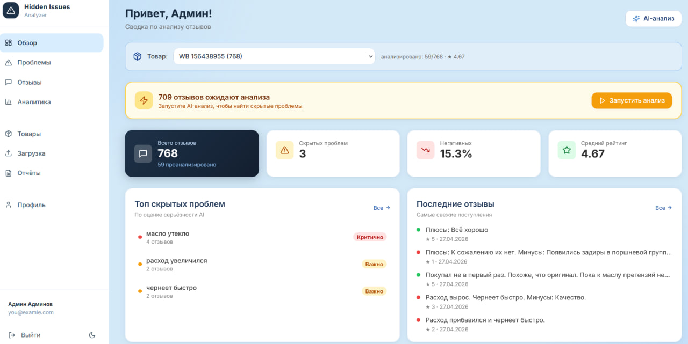
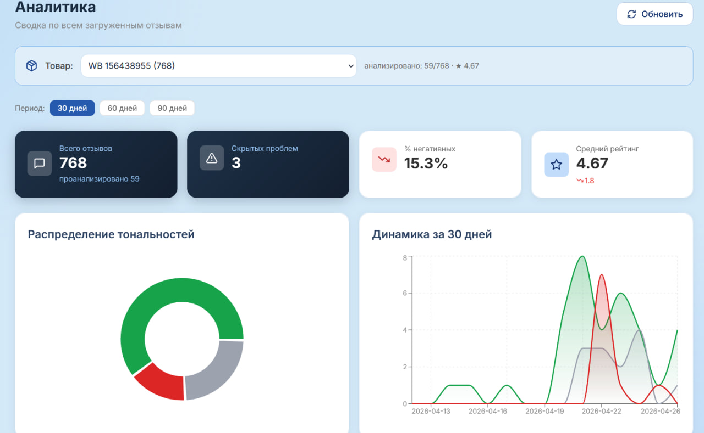
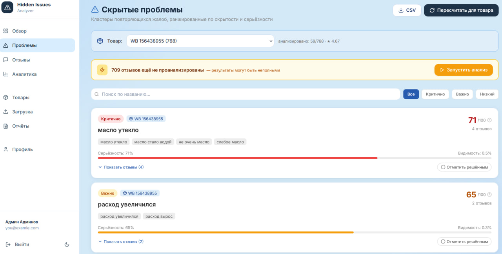
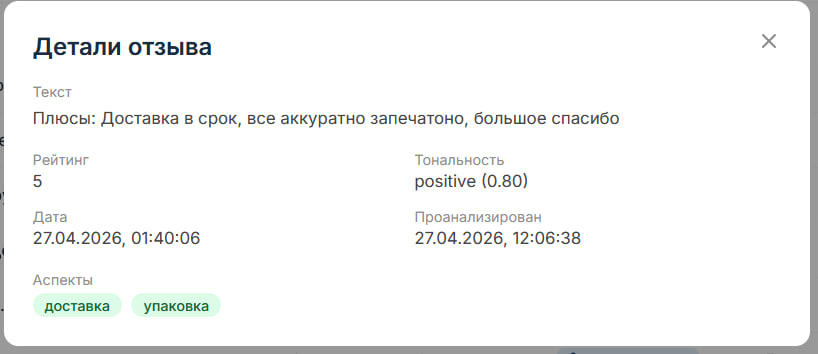
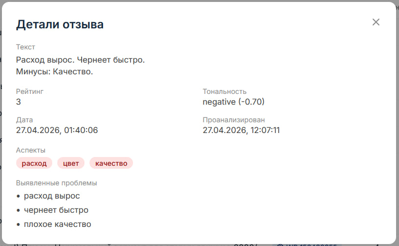

## Данные об авторе
Сакович Евгений Сергеевич
sakovich_es_23
3 курс / 6 семестр
Специальность Искусственный интеллект
Вид проекта - курсовая работа

# ReviewLens

Интеллектуальная система анализа отзывов о товарах с **выявлением скрытых проблем**.

Пользовательские данные требуют авторизации и доступны владельцу товара.
Access token хранится в памяти клиента, refresh — в HttpOnly cookie;
после перезагрузки сессия восстанавливается, выход отзывает её на сервере.
Новые импорты сохраняют происхождение; правила переходного периода и
проверки изоляции описаны в [docs/ownership.md](docs/ownership.md).
CSV загружается через предпросмотр и сопоставление колонок; товар выбирается
явно, ошибки строк можно скачать. Формат и пределы: [docs/csv-import.md](docs/csv-import.md).

## Спецификация следующей версии

- [Поведение первой версии и критерий скрытой проблемы](docs/product-spec.md)
- [25 размеченных примеров и правила проверки](docs/fixtures/README.md)
- [Сценарии приёмки и измеряемые ограничения](docs/acceptance.md)

Документы задают целевое поведение. Расхождения с текущей реализацией указаны
в спецификации. Проверить согласованность примеров: `node scripts/validate-review-cases.mjs`.

## Что умеет

- Загрузка отзывов: CSV / ручной ввод / парсинг Wildberries
- LLM-анализ: локальный HTTP-провайдер или явно выбранный OpenRouter; тональность, аспекты, проблемы
- Кластеризация жалоб через эмбеддинги (`@xenova/transformers`) + DBSCAN
- Метрика **hidden_score = severity × (1 − visibility)** — ранжирует «скрытые» проблемы
- AI executive summary — LLM формирует краткий аналитический вывод по продукту
- Управление продуктами: фильтрация всех данных по продукту, переименование, удаление
- Статус **resolved** для скрытых проблем с оптимистичным UI-переключением
- 9 страниц UI: Дашборд, Загрузка, Аналитика, Скрытые проблемы, Отзывы, Отчёты, Парсинг, Продукты, Профиль
- Real-time прогресс анализа через Socket.IO
- Экспорт PDF / DOCX отчётов
- Dark mode, мобильный sidebar с hamburger-меню

## Скриншоты

### Дашборд


### Аналитика


### Скрытые проблемы


### Детали отзыва — позитивный


### Детали отзыва — негативный


## Стек

| Слой | Технологии |
|---|---|
| Frontend | React 18, TypeScript, Vite, **Recharts**, TanStack Query, Zustand, react-router-dom 6, react-dropzone, react-hot-toast, lucide-react |
| Backend | Node.js 24, Express 5, TypeScript, **Zod**, multer, helmet, cors, express-rate-limit, morgan, pino |
| Realtime | Socket.IO |
| Database | PostgreSQL 16 + **Prisma** ORM |
| Cache | Redis 7 (ioredis) |
| Auth | JWT access + refresh с ротацией в БД (bcryptjs) |
| ML / NLP | **OpenRouter** (NVIDIA Nemotron) + `@xenova/transformers` (ONNX) + `density-clustering` (DBSCAN) |
| Reports | pdfkit, docx |
| Парсинг | нативный fetch к feedbacks API Wildberries |
| Infra | Docker, docker-compose |

## Структура

```
hidden-issues-analyzer/
├── apps/
│   ├── api/                    # Express + Prisma + Socket.IO
│   │   ├── prisma/schema.prisma
│   │   └── src/
│   │       ├── config/         # zod env
│   │       ├── lib/            # prisma, redis, logger, openrouter, embeddings
│   │       ├── middleware/     # auth, validate, error
│   │       ├── routes/         # auth, reviews, analysis, issues, reports, parsing, products, profile
│   │       ├── controllers/
│   │       ├── services/       # analyzer, clustering, summary, products, reports, parsing, stats, reviews, auth
│   │       ├── schemas/        # zod
│   │       ├── sockets/
│   │       └── index.ts
│   └── web/                    # React + Vite
│       └── src/
│           ├── components/     # Layout, Sidebar, ProductSelector, AiSummaryModal, AnalysisBanner, ProtectedRoute
│           ├── pages/          # Dashboard, Upload, Analytics, Issues, Reviews, Reports, Parsing, Products, Profile + Login/Register
│           ├── lib/            # api (axios), socket, queries (react-query)
│           └── store/          # auth.store, product.store (zustand)
├── docker-compose.yml          # postgres + redis
├── package.json                # workspaces root
└── .env.example
```

## Запуск (с нуля)

```powershell
# 1. Node.js 24 (точная проверенная версия в .nvmrc), npm 10 или 11
# Docker Desktop должен быть запущен
npm ci

# 2. Поднять Postgres + Redis
npm run docker:up

# 3. Создать .env-файлы
copy .env.example .env
copy apps\api\.env.example apps\api\.env
copy apps\web\.env.example apps\web\.env
# По умолчанию local: настроить LLM_BASE_URL и LLM_MODEL для отдельно установленного runtime.
# Для облака выбрать LLM_PROVIDER=openrouter, облачные URL/model и OPENROUTER_API_KEY.

# 4. Сгенерировать клиент и применить сохранённые миграции БД
npm run db:generate
npm run db:deploy
npm run db:check

# 5. Запустить dev (api + web + worker параллельно)
npm run dev
```

- API:  http://localhost:4000
- Web:  http://localhost:5173

## Команды

```bash
npm run dev            # api + web + worker в dev-режиме
npm run build          # production build
npm run lint           # ESLint
npm run test           # Vitest
npm run typecheck      # TypeScript в обоих workspace, включая конфиги web
npm run check          # typecheck + lint + test + production build
npm run docker:up      # postgres + redis
npm run docker:down    # остановить
npm run db:migrate     # создать новую миграцию при изменении schema.prisma
npm run db:deploy      # применить существующие миграции, включая чистую БД
npm run db:generate    # prisma generate
npm run db:check       # соединение с PostgreSQL, таблица Product и Redis PING
npm run start:api      # API из production build
npm run start:worker   # отдельный worker из production build
npm run preview:web    # локальный просмотр собранного web
```

Подробности воспроизводимости, ограничения worker и результаты проверки:
[docs/development.md](docs/development.md).

Режимы LLM, проверка доступности, таймауты и ограничения:
[docs/llm-provider.md](docs/llm-provider.md). При отсутствии модели импорт
остаётся доступен; реальная локальная модель ещё не проверялась на втором ПК.

Переходная модель данных, правила назначения владельцев старых записей и
проверка миграции на отдельной БД: [docs/data-migration.md](docs/data-migration.md).

## Workflow использования

1. **Регистрация** на `/register`
2. **Загрузка**: выбрать товар или создать новый, проверить CSV и сопоставить колонки,
   затем импортировать корректные записи; либо ввести отзыв вручную / указать WB-ссылку
3. На **Дашборде** выбрать продукт через `ProductSelector` — все данные фильтруются глобально
4. На странице **Отзывы** нажать «Запустить анализ» — LLM проанализирует пачку, прогресс — real-time
5. На **Аналитика** появятся метрики, графики и кнопка «AI Summary» (LLM-вывод по продукту)
6. На **Скрытые проблемы** нажать «Пересчитать» — DBSCAN-кластеризация; проблемы можно отметить как resolved
7. На **Отчёты** сгенерировать PDF или DOCX

## Ключевые API эндпоинты

```
POST   /api/auth/register        регистрация
POST   /api/auth/login           вход
POST   /api/auth/refresh         обновление токена
GET    /api/auth/me              текущий пользователь

POST   /api/reviews/upload/csv   multipart файл
POST   /api/reviews/upload/text  ручной отзыв
GET    /api/reviews              пагинация + фильтры
GET    /api/reviews/:id

POST   /api/analysis/run         { limit? } — анализ pending отзывов (jobId)
GET    /api/analysis/stats       сводка
GET    /api/analysis/timeseries  динамика по дням
GET    /api/analysis/summary     AI executive summary (LLM, ?productId)

GET    /api/issues               список скрытых проблем (?productId, ?severity, ?search)
POST   /api/issues/recompute     пересчитать кластеры
GET    /api/issues/:id
PATCH  /api/issues/:id/resolve   переключить статус resolved

GET    /api/products             список продуктов
PATCH  /api/products/:id         переименовать продукт
DELETE /api/products/:id         удалить продукт

POST   /api/parsing/start        { url } — парсинг WB

POST   /api/reports/generate     { format: 'pdf'|'docx', title? }
GET    /api/reports
GET    /api/reports/:id/download

GET    /api/profile/stats
```

## WebSocket события (Socket.IO)

```
client → server: 'job:subscribe' (jobId)
server → client: 'analysis:progress' { jobId, processed, total }
server → client: 'analysis:complete' { jobId }
server → client: 'analysis:error'    { jobId, message }
```

Устойчивая очередь, история запусков, отмена и проверка worker:
[docs/analysis-worker.md](docs/analysis-worker.md). Запуск требует выбранного товара.
